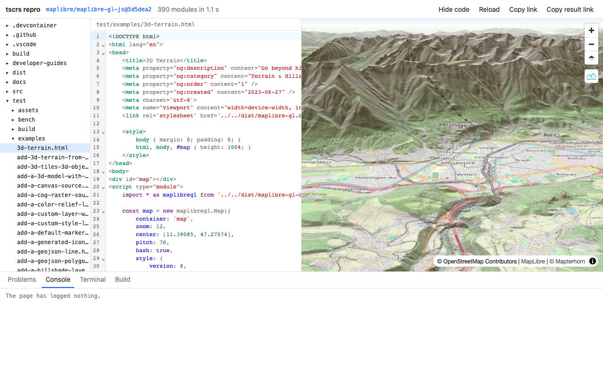

# livebranch

A playground that runs a TypeScript project in the browser, straight from a GitHub commit. The
TypeScript compiler itself ([tsc-rs](https://github.com/pingdotgg/ts-rust), compiled to WebAssembly)
compiles the sources in the tab, and the page loads the result as native ES modules. There is no
bundler, no container and no server. A link holds everything needed to run it.



It was made to share a branch of maplibre-gl-js with a demo page, and it works for any TypeScript
library that a page can import.

## Links

Everything is in the fragment of the URL, so nothing is sent to a server.

| Parameter | Meaning |
| --- | --- |
| `gh=owner/repo@ref` | The project. A branch, a tag or a commit. `owner/repo@pull/123` is the head of a pull request, also one from a fork. The URL of a branch, a commit, a pull request or a file on github.com works too. `owner/repo@ref:sub/dir` uses a directory of the repository as the project root. |
| `base=ref` | A second ref to run the same page against, shown next to the first. A ref of the same repository (`main`, a tag) or a full `owner/repo@ref`. |
| `gist=id` | Files of a gist, laid over the project. `id@revision` pins it. |
| `code=...` | Files carried in the link itself (JSON, deflate, base64url), laid over everything else. |
| `entry=path` | The page to open, or a script to run. The default is the page or the script among the link's files, or else what the project's config names. |
| `adapter=name` | The adapter to use. `none` turns off the lookup by package name. |
| `view=result` | Show only the built page. |
| `nocache` | Build again even when this browser has the build. |

A branch of maplibre-gl-js needs only `#gh=birkskyum/maplibre-gl-js@my-branch`, and a pull request
only `#gh=maplibre/maplibre-gl-js@pull/8628`. Add `&entry=test/examples/3d-terrain.html` to open one
of the repository's own example pages, as it is in that branch. A link that names a branch or a
pull request shows its latest push. A link that names a commit never changes.

A demo does not need a page. A link can carry a `demo.ts` alone, which runs in a page made from
the project's template. For maplibre-gl-js that page has the stylesheet and a full-size `#map`.
With `base=main` the same script runs against main and against the branch, side by side. The
Compare button in the header does the same: its first click adds the repository's default branch,
and after that it changes the ref or stops comparing. A pull request that is opened by its GitHub
address (`livebranch.dev/owner/repo/pull/123`) starts next to the default branch.

A page may hold TypeScript in its inline `<script type="module">`. Imports of npm packages load
from esm.sh, at the version that the project's `package-lock.json` or `package.json` names. An
import of the project's own package name resolves to `src/index.ts`.

## What a build does

1. It lists the files of the commit with one GitHub API request and fetches only the files that
   the page reaches through imports, from raw.githubusercontent.com.
2. It runs the project's setup commands, such as code generators, in a worker that gives them
   `fs`, `path`, `glob` and `process` over the project's files.
3. tsc-rs compiles the page's scripts and everything they import at run time, without type
   checking. For maplibre-gl-js that is about 390 modules in under a second.
4. Imports in the output are rewritten to the paths of their sources and to CDN URLs, and a
   service worker serves the result from the Cache API under `~p/<build id>/`.
5. In the background, tsc-rs type checks the page and the link's files against the project and
   the type declarations of its npm dependencies. The problems show up next to the preview.

A build is kept in the browser by a hash of its inputs. Opening the same link again takes a few
milliseconds. The first build of a maplibre-gl-js commit takes about four seconds.

## From a GitHub address

On the deployed Worker, a GitHub address also works as a path. Put the site's address in front of
any GitHub URL of a repository, a branch, a pull request, a commit or an example file, or swap
`github.com` for it. `livebranch.dev/github.com/maplibre/maplibre-gl-js/pull/8628` and
`livebranch.dev/maplibre/maplibre-gl-js/pull/8628` both open that pull request.

## Project config

A project says how it runs in a `livebranch.json`, at its root or in `.github`. A project without
one gets its adapter, which is the same kind of file kept in
[livebranch-adapters](https://github.com/birkskyum/livebranch-adapters) under the `name` of the
project's package.json. An adapter names the repository it is for, and applies to that repository
and to projects whose package.json points at it, which forks do. Anyone can add an adapter there. The project's own file wins over its
adapter, field by field. In these files a long text (`template`, a value of `files`) may be an
array of lines.

| Field | Meaning |
| --- | --- |
| `entry` | The page to open, or the script to run. |
| `template` | The page for an entry that is a script. `<!--entry-->` marks where the script goes. |
| `setup` | Shell commands that run before the build. `node script.ts` runs the script in the browser. |
| `alias` | Bare import specifiers that point at a project file or a URL. |
| `entries` | Modules that nothing imports statically but the page loads, such as worker scripts. |
| `files` | Extra files, written when the project does not have them. |
| `prebuilt` | Generated files to take from the project's published npm package, for generators that cannot run in a browser. A warning is reported when the generator's sources differ from the release's. |
| `cdn` | `esm.sh` (the default) or `jsdelivr`. |

## Terminal

The Terminal tab is a bash over the project's files ([just-bash](https://github.com/vercel-labs/just-bash)).
`tsc` there is tsc-rs with its full command line, `node` runs a script as the setup commands do,
and `npm run` runs a script of package.json through the same shell.

## Command line

```sh
# A link for a page laid over a branch. The branch is pinned to its commit.
node bin/livebranch.ts link --gh birkskyum/maplibre-gl-js@my-branch demo.html

# A script against a branch and against main, side by side.
node bin/livebranch.ts link --gh birkskyum/maplibre-gl-js@my-branch --base maplibre/maplibre-gl-js@main demo.ts

# A link that follows a pull request, for the PR's own description.
node bin/livebranch.ts link --follow --gh https://github.com/maplibre/maplibre-gl-js/pull/8628

# The same pipeline under Node: compile and type check, print the problems, exit 1 on errors.
node bin/livebranch.ts check --dir ~/repos/maplibre-gl-js demo.html
node bin/livebranch.ts check --json demo.html helper.ts
```

`LIVEBRANCH_BASE` or `--site` sets the URL of the app for `link`. The default is livebranch.dev. Setup commands do not run
under Node, so `check` of a project that needs them wants a directory where they have run.

## Worker and HTTP API

The engine does not depend on the browser, so `worker/index.ts` also runs it in a Worker. The
Worker serves the static app and an API, which `public/llms.txt` describes for the people and the
agents that use the site.

- `POST /api/link` makes a link from a source and files, so that a caller does not have to encode
  the `code` parameter.
- `POST /api/check` compiles and type checks without a browser and returns the problems as JSON.
- A GitHub address as the path redirects to its link (see above).

`wrangler.jsonc` describes the Worker. `pnpm exec wrangler dev` runs it in a local workerd, and
`wrangler deploy` puts it on livebranch.dev. The same config is what celld reads for self-hosting,
which has not been tried here.

The Worker has no GitHub token of its own and needs none for branches, tags, pull requests and
commits, which it reads through GitHub's git endpoint. For a gist or an abbreviated commit hash a
caller sends a token of their own, and the Worker passes it on. One address gets 30 requests a
minute to the link and check endpoints, and 300 to the GitHub reader.

Setup commands do not run in the Worker or under Node yet. A project that has them is still
checked, but problems are then reported only for the page and the link's files.

The Worker checks a program of up to 1.4 MB of source (`SOURCE_BUDGET` in `worker/index.ts`), where
a declaration file counts for a quarter of its size. A larger one gets status 422 right away,
because the compiler would need more memory than a Worker has: about 200 MB for maplibre-gl-js.
The command line and a browser have no such limit.

## For agents and tests

A link can be made without a browser and without an account. `/api/check` and `livebranch check` answer
whether it compiles and type checks. Any headless browser can open the link, and the page says how
it went.

- `document.documentElement.dataset.livebranch` is `loading`, `ready` or `failed`.
- `window.__livebranch.state` has the session (`session.problems`, `session.steps`, `session.url`), the
  type errors (`typeProblems`, final when `checking` is false) and the page's console (`console`).
- `window.__livebranch.exec('grep -rn foo src')` runs a shell command over the project.
- `window.__livebranch.edit('/index.html', text)` changes a file and rebuilds.
- `window.__livebranch.link()` returns the link with the edits in it.

## Development

```sh
pnpm install
pnpm dev            # the app, with the engine in a worker
pnpm test           # the engine under Node
pnpm check:types    # with tsc-rs
pnpm check:browsers # the live site in Firefox, WebKit and Chromium (needs Playwright's browsers)
pnpm build          # static files in dist, for any host that serves over HTTPS
pnpm exec wrangler dev   # the built app and the API in a local workerd
```

`public/tsc/ts_rust.wasm` is built from ts-rust at the commit that `scripts/build-wasm.sh` pins.
The script needs Rust with the `wasm32-wasip1` target. The module here is built without wasm-opt
(5.9 MB, 1.8 MB with Brotli).

## Limits

- The preview runs on the app's own origin, because a service worker serves it. Do not keep
  anything private on that origin.
- Refs and file lists are read through GitHub's git endpoint (`src/engine/sources/git.ts`), which
  has no hourly allowance. A browser may not ask that endpoint, so the Worker does it for the page
  at `/api/github/*`. Without the Worker (the dev server, a static host) the page asks GitHub's
  API, where an anonymous address gets 60 requests an hour. Gists always go through the API.
- A check in the Worker of a project near its size limit makes a few hundred requests to GitHub
  and npm, which needs a paid Workers plan on Cloudflare. Nothing is cached there yet.
- Setup scripts get a small part of Node. A script that needs more, or that downloads from a
  host without CORS, needs its output listed under `prebuilt`.
- Packages from the CDN are bundled per package, so two copies of a shared dependency can load.
- A script's own `import()` of a computed project path is not compiled unless `entries` names it.
- tsc-rs is new, and its authors say so. The emit here matched byte for byte with and without the
  default libs on maplibre-gl-js, which is the only large project tried so far.
